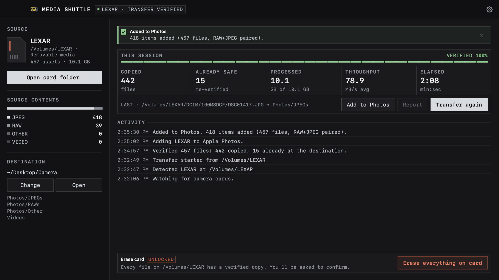

# Media Shuttle

Copies photos and videos off camera cards, checks every copy with SHA-256, and only lets you erase the card once every file has a verified copy. For macOS, Windows and Linux.

Website: [mediashuttle.webworldwide.online](https://mediashuttle.webworldwide.online)



## Features

- Finds camera media in `DCIM`, `M4ROOT` and `PRIVATE` folders, or in any folder you choose.
- Sorts files into `Photos/JPEGs`, `Photos/RAWs`, `Photos/Other` and `Videos`, optionally by date.
- Hashes each file on the card and at the destination, and keeps the copy only if they match.
- Skips files that are already at the destination. A different file with the same name is saved as `NAME (2)`.
- Can start a transfer automatically when a card is inserted, and send a notification when it finishes.
- Erase unlocks only after a verified transfer. Before deleting, it checks every file against its copy again, refuses if the card has files it can't verify, and asks you to type `ERASE EVERYTHING`. It deletes files but doesn't format the card.

On macOS:

- **Add to Apple Photos** (Media menu, ⇧⌘P), or automatically after each transfer. RAW+JPEG pairs become one photo, and files already added are skipped. BRAW, R3D, MXF and AVCHD aren't supported by Photos and stay in the destination folder.
- **Menu bar panel** with the card, progress, recent activity, and buttons to transfer, add to Photos, eject and change the automatic settings.

## Download

Download from [GitHub Releases](https://github.com/WebWorldWide/media-shuttle/releases). Each release includes SHA-256 checksums.

- **macOS 14 or later:** open `MediaShuttle-v*-macOS-universal.dmg` and drag the app to Applications. Releases are signed and notarized.
- **Windows 10 or 11:** run `MediaShuttle-Setup-v*-win-x64.exe`, or unzip `MediaShuttle-v*-win-x64.zip`. Windows builds aren't signed, so SmartScreen may warn the first time.
- **Linux:** download `MediaShuttle-v*-linux-x86_64.flatpak` (or `-aarch64` for ARM) and open it, or run `flatpak install MediaShuttle-v*-linux-x86_64.flatpak`. It installs the GNOME runtime from Flathub if you don't have it.

## Build

### macOS

Needs Xcode 26 or later.

```bash
swift run --package-path macos MediaShuttle
swift test --package-path macos
./macos/scripts/package-macos.sh 0.2.1
```

`package-macos.sh` makes an ad-hoc signed DMG by default. To sign and notarize, save notary credentials once and pass your Developer ID:

```bash
xcrun notarytool store-credentials media-shuttle-notary --apple-id you@example.com --team-id TEAMID

CODE_SIGN_IDENTITY="Developer ID Application: Your Name (TEAMID)" \
NOTARY_KEYCHAIN_PROFILE=media-shuttle-notary \
./macos/scripts/package-macos.sh 0.2.1
```

You can use an App Store Connect API key instead by setting `NOTARY_KEY_PATH`, `NOTARY_KEY_ID` and `NOTARY_ISSUER`.

### Windows

Needs the .NET 8 SDK, and Inno Setup 6 for the installer.

```powershell
.\windows\build.ps1 -Clean
.\windows\install.ps1
```

`-SkipInstaller` builds only the portable version. `build.ps1` runs the tests first.

### Linux

Needs Python 3 with GTK 3 and Cairo bindings. On Ubuntu or Debian: `python3-gi`, `gir1.2-gtk-3.0`, `python3-gi-cairo` and `python3-cairo`.

```bash
./linux/media-shuttle
PYTHONPATH=linux python3 -m unittest discover -s linux/tests -v
./linux/install.sh   # installs for your user and adds ~/.local/bin/media-shuttle
```

To build the Flatpak yourself:

```bash
flatpak-builder --user --install --force-clean build linux/flatpak/io.github.adamnolle.MediaShuttle.yml
```

On Linux, erase works only on a removable volume selected at its root. Folders you choose can be transferred but not erased.


## Website and video

The website is in `site/` and is published to GitHub Pages when it changes. `docs/video/build.sh` renders the demo video and the images the site uses from the macOS app's own views.

## CI and releases

GitHub Actions runs the tests for all three platforms on every push and pull request. Pull requests from forks run on GitHub-hosted machines. Pushing a `v*` tag builds the Windows, macOS and Linux Flatpak releases and attaches them to the same GitHub release.

## Privacy

Media Shuttle doesn't connect to the internet or collect analytics. Settings, logs and transfer reports stay on your computer. Add to Photos asks only for permission to add items, not to read your library.

## License

[MIT](LICENSE)
